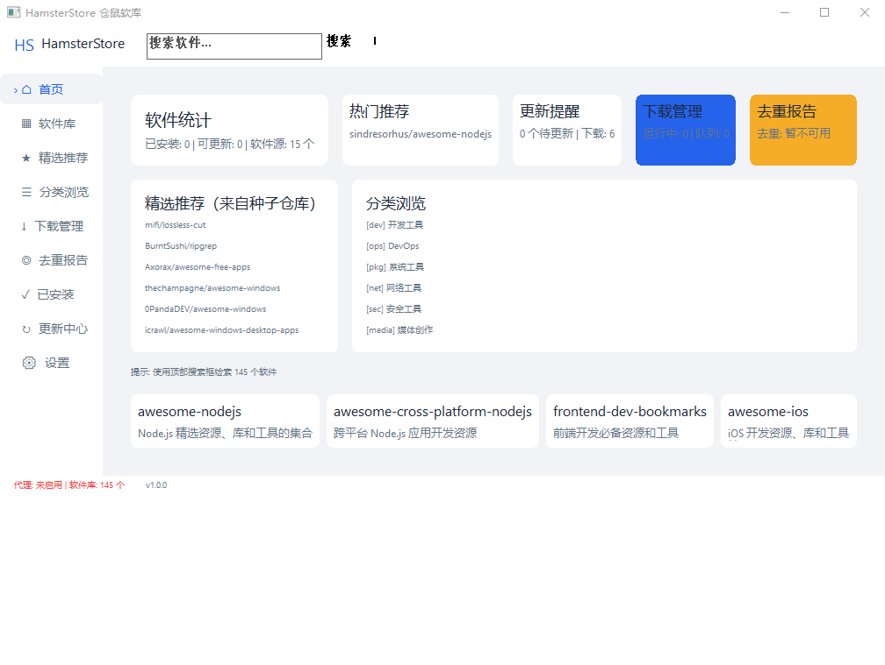

# HamsterStore - 仓鼠软库

跨平台开源软件仓库管理工具。基于 Perry 框架 (TypeScript 编译为原生二进制)，主题色 #2563EB。

## 技术栈

- **Perry v0.5.1520**（锁版）— TypeScript to native compiler (LLVM + Clang + LLD，无 MSVC 依赖，搭建见 [docs/BUILD.md](docs/BUILD.md)；1664/1665 GUI 库有上游打包事故，见 [docs/PERRY_COMPLIANCE.md](docs/PERRY_COMPLIANCE.md))
- **FileDB** — 纯 TS JSON 持久化 (~/.hamsterstore/filedb/*.json)，手写 SQL 子集解析，绕过 better-sqlite3 stub
- **netFetch** — 统一网络原语：spawn curl (数组参数) + 输出文件大小轮询，回调式，零 Promise/子进程事件依赖
- **CategoryEngine** — 17 类标准分类 + 关键词推断
- **DedupEngine** — 精确 URL Hash + Jaccard 模糊去重（tokenize 用字符遍历，避开 Perry 正则链接限制）
- **ProxyManager + HamsterProxy** — GitHub 镜像加速链（预算制测速 + 30min 缓存 + 失败熔断 + 直连回退）
- **concurrent** — ThreadPool (有界分片并行) / TaskQueue (背压) / Channel (进度) / AtomicCounter + RateLimiter

## 项目结构

```
src/
  main.ts               # CLI 入口 (v1.4)
  gui/main.ts           # GUI 入口 (v2，完整 Bento UI，见下文)
  core/
    sync/               # SourceSyncer + GitHubAPIClient + BuiltInData(132) + seedRepos(15)
    discovery/          # GitHubSearchEngine (公开搜索，netFetch 回调式)
    categorization/     # CategoryEngine (17 类)
    dedup/              # DedupEngine + DedupCleaner
    download/           # DownloadManager (netDownload + 代理回退) + ReleaseResolver (release 资产解析/评分/缓存)
    proxy/              # ProxyManager + HamsterProxy + 代理节点
    net/                # netFetch (GET/HEAD/下载原语)
    concurrent/         # 并发基础设施（深拷贝分片并行，见模块头注释）
  data/
    FileDB.ts           # JSON 文件持久化 + SQL 子集
    Database.ts         # 入口初始化
    models/             # 7 数据模型
    repositories/       # 6 Repository CRUD
  tests/
    concurrent.test.ts  # 并发基础设施 59 断言
    filedb.test.ts      # FileDB SQL 子集 + 原子写盘 + Repository 写回 26 断言
    release.test.ts     # Windows 资产评分选择 19 断言
    net.test.ts         # 网络完整性契约 10 断言（需外网）
  types/                # 共享类型
```

## CLI 命令

```bash
hamsterstore sync                # 同步内置数据 (132 包) + 种子仓库 (15) 到本地库
hamsterstore discover [kw]       # GitHub 在线搜索发现
hamsterstore search <关键词>      # 本地搜索 -> GitHub 在线搜索
hamsterstore download <id>       # 解析最新 release 的 Windows 资产并下载（评分选择+缓存，经加速器，失败直连回退）
hamsterstore bench [n] [p]       # 去重打分基准：串行 vs 并行
hamsterstore proxy               # 查看加速器状态（自动测速）
hamsterstore info <ID>           # 查看软件详情
hamsterstore list                # 显示仓库 + 软件包列表
hamsterstore categories          # 分类统计
hamsterstore dedup               # 全库去重扫描
hamsterstore help                # 帮助

# 选项: --token <PAT>  (无 token 时采用爬虫方案)
```

## 构建与测试

```bash
npm install                    # 安装依赖 (perry 0.5.1520，lockfile 锁定)
npm run check                  # perry check 类型检查（无需工具链）
npm run test                   # 离线回归：并发 59 + FileDB 26 + 资产选择 19 断言（真实二进制）
npm run test:net               # 网络回归：下载完整性/404 拒绝（需外网，10 断言）
npm run build:cli              # dist/HamsterStore.exe (~13 MB) + attest
npm run build:gui              # dist/HamsterStore-GUI.exe + .pdb + attest
npm run build:all              # 双编译
```

**首次构建前必须搭建工具链**（LLVM + xwin Windows SDK + Rust + perry v0.5.1520
源码树，全部用户级安装，无需管理员权限）：完整步骤见 [docs/BUILD.md](docs/BUILD.md)。
要点：1520 的 npm stdlib 缺正则运行时入口，`PERRY_WORKSPACE_ROOT` 指向源码树后由
cargo 重建 runtime+stdlib 补全（脚本已封装，首次数分钟，之后走缓存）；UI 库手动解
压到 `libs-ui/`；含 try/catch 的模块必须 `PERRY_RS4GC=0`（上游 #7354）。
**新增代码避免用 class 封装带 GC roots 的方法**（#14982 前瞻规则，用工厂函数 +
对象字面量）。

## GUI 现状

生产 GUI 入口 (`src/gui/main.ts`) 是完整 **Bento UI（9 页面）**：首页统计 / 软件库 /
精选推荐 / 分类浏览 / 下载管理 / 去重报告 / 已安装 / 更新中心 / 设置，对标 Microsoft Store。
Perry 锁 0.5.1520，实机渲染 145 个软件包、15 个源。



**2026-11-20 崩溃根因定位**（详见 [docs/CRASH_REPRO.md](docs/CRASH_REPRO.md)）：
08-10 `EXCEPTION_STACK_OVERFLOW` 的真因不是 UI 代码递归，而是上游 0.5.166x
npm 发布包的 `perry_ui_windows.lib` 内嵌了**第二份 perry_runtime**（独立 cargo
解析，元数据 hash 不同），链接后 exe 的 `.perryat` 段出现两个 `ATOM_START` 标记 →
运行时 `seed_static_atoms` 按 24 字节步长解析错位 → 在用户代码之前崩溃；任何容器
控件（VStack/HStack/Button/Divider）必崩也由此而来。0.5.1520 的 runtime/stdlib/UI
出自同一工作区（单一标记），完整 UI **实机运行 14 分钟+ 无崩溃**。1664/1665 的
证据链、探针矩阵与升级门禁见 [docs/PERRY_COMPLIANCE.md](docs/PERRY_COMPLIANCE.md)。

已知遗留：DownloadManager v5 的 getState/getQueued 仍是 stub；9 个导航页的点击巡检
建议人工过一遍（本机仅验证了窗口渲染、输入注入与事件循环稳定性）。

## 数据流向

```
BuiltInData (132 包) ─┐
                      ├─> SourceSyncer ─> CategoryEngine (17 类) ─> FileDB JSON
seedRepos (15 源) ────┘                                               │
                                                                      v
GitHub Search ─> GitHubSearchEngine ─> (search/discover 命令)    CLI list/info
                                                                      │
下载: download <id> ─> ReleaseResolver（缓存快路径 / getLatestRelease + pickWindowsAsset 评分）
      ─> DownloadManager ─> ProxyManager.accelerateDownload ─> netDownload (curl -f + 长度校验)
      代理失败 ─> markFailed + 直连重试一次；解析结果写回包缓存（version/download_url）
```

注：README 旧版描述的「种子仓库 README 爬取 → 7 解析器」管线已废弃移除，
当前 sync 为离线内置数据注入；在线数据经 GitHub Search API。

## Perry 适配要点

- **`prepare().run(...params)` 截断**：最多 7 个参数, 超出丢弃. 解决:`extra_json` 字段聚合
- **预编译 better-sqlite3 stub**：`prepare()` 返回 undefined. 解决: FileDB 纯 TS JSON 替代
- **`setTimeout` 回调非 UI 线程 SIGSEGV**：解决: 自旋 sleep 同步等待（CLI 保活用 setInterval）
- **npm stdlib 缺正则入口（1520）**：`js_regexp_new` 等 5 符号链接缺失. 解决: `PERRY_WORKSPACE_ROOT` 源码重建 runtime+stdlib（docs/BUILD.md §2.4）
- **try/catch + RS4GC（1520）**：WinEH funclet 与 statepoint pass 不兼容 (#7354). 解决: `PERRY_RS4GC=0`（脚本已封装；1665 起上游修复）
- **上游 GUI 库打包缺陷（1664/1665）**：`perry_ui_windows.lib` 内嵌第二份 runtime → `.perryat` 双 `ATOM_START` → 启动即崩（容器控件必崩）. 解决: 工具链锁 0.5.1520，升级门禁见 docs/PERRY_COMPLIANCE.md
- **class 方法 $pshape COFF alias（#14982，1665+）**：compact-map rewriter 拒绝整模块. 1520 不触发；4 模块已预防性重构为对象字面量工厂
- **子进程事件回调不可靠**：stdout/close 回调在真实二进制不触发. 解决: netFetch 文件轮询
- **emoji 在字符串中**：替换为 ASCII 标识
- **subsystem=windows 无 cmd 指令窗口**

## License

MIT
